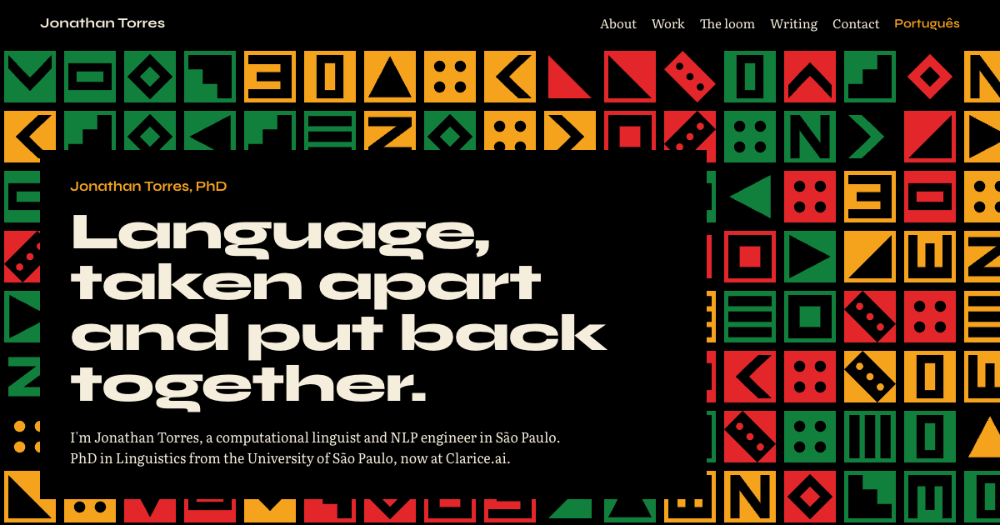
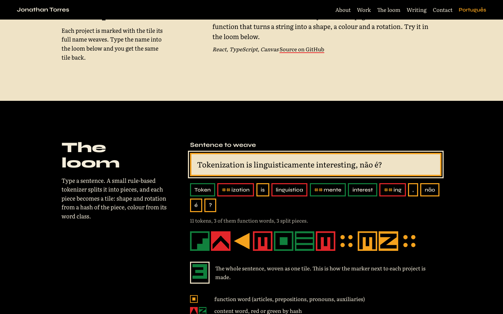

# jon-torres.github.io

Personal site of Jonathan Torres, computational linguist and NLP engineer.
Live at [jon-torres.github.io](https://jon-torres.github.io/) (English) and
[jon-torres.github.io/pt/](https://jon-torres.github.io/pt/) (Portuguese).



## The idea

Kente and bògòlanfini are encoded systems: a pattern is a message. So is text
to an NLP engineer. The site treats the page as a strip cloth and every token
as a tile. One deterministic function (`src/lib/tiles.ts`) turns a string into
a shape, a rotation and a colour, and that single mapping drives the hero
cloth on a canvas, the markers next to each project and role, and "the loom",
where a visitor types a sentence and watches a small rule-based tokenizer
turn it into cloth.

Colour is data. In the loom, gold is a function word, red or green a content
word, black with gold dots punctuation. In the career chart, red is industry,
green research, gold teaching.



## Stack

- [Vite](https://vite.dev) + React 19 + TypeScript, no UI framework.
- Fonts self-hosted through `@fontsource-variable` (Syne for display,
  Literata for text).
- Canvas 2D for the hero; inline SVG for every other tile. Both read the same
  SVG path data, so there is one source of truth for the glyphs.
- Prerendered to static HTML per locale at build time (`scripts/prerender.mjs`),
  so search engines index real content without running JavaScript. Each page
  carries canonical and `hreflang` links, Open Graph tags and a JSON-LD
  `Person` record.
- Vitest for the pure modules (hash, tokenizer, tile mapping).

## Working on it

```sh
pnpm install
pnpm dev          # http://localhost:5173 (English) and /pt/ (Portuguese)
pnpm test         # unit tests
pnpm lint         # eslint
pnpm format       # prettier
pnpm build        # type-check, bundle, prerender into dist/
pnpm preview      # serve dist/ locally
```

Node 22 or later and pnpm 10 or later.

## Layout

```
src/
  components/   page sections and the Cloth, Tile, Strip, Loom, Timeline pieces
  content/      all copy, per locale (en.ts, pt.ts) plus shared links and data
  lib/          hash, tokenizer and tile mapping, with tests
  styles/       one global stylesheet with the design tokens at the top
  App.tsx       page composition
  main.tsx      client entry (hydrates the prerendered HTML)
  entry-server.tsx  server entry used by the prerender step; also builds <head>
scripts/
  prerender.mjs renders dist/index.html, dist/pt/index.html and dist/404.html
  check-pt.py   local style check for the Portuguese copy (gitignored)
public/         favicon, photo, robots.txt, sitemap.xml, og.png
docs/           design spec
```

## Editing content

Everything visible lives in `src/content/`. English in `en.ts`, Portuguese in
`pt.ts`, and links, tools and essay lists that are the same in both languages in
`shared.ts`. The two locale files share the `Content` type in `types.ts`, so a
field added to one has to be added to the other.

The Portuguese copy is checked with `pnpm check:pt`, which runs a local,
gitignored style checker. Without that script the command does nothing useful.

## Deploying

Every pull request runs the test and build job in `.github/workflows/deploy.yml`.
Pushing to `main` runs the same job and then
publishes `dist/` to GitHub Pages. The repository's Pages source is set to
GitHub Actions.

The same build works on Vercel with no extra configuration: import the
repository and it picks up `vercel.json`.

## Licence

Code is MIT (see `LICENSE`). The text, photo and other content are
© Jonathan Torres and are not covered by that licence.
